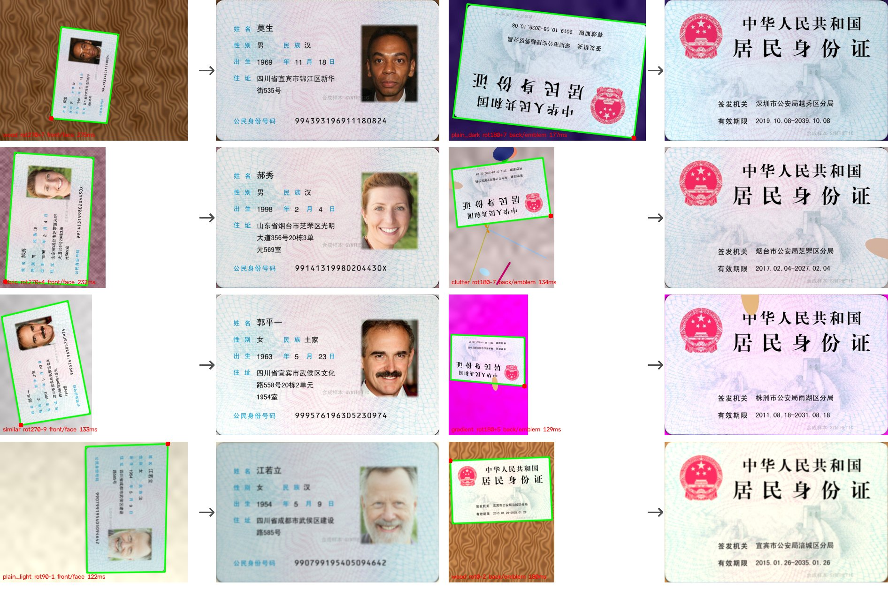

# 身份证照片自动裁剪 + 摆正（离线 / 纯 CPU）

拍摄的二代身份证照片（人像面或国徽面）→ 自动找到卡片、裁掉背景、透视拉正、文字转正，输出标准尺寸的卡面图。

- **不需要 GPU，不联网**：只依赖 OpenCV + numpy，外加一个 227KB 的人脸检测模型（YuNet，MIT 协议）
- **速度**：4 核约 150ms/张，单线程约 200ms/张（1200 万像素照片单线程约 310ms）
- **输出**：默认 1011×638，即 300dpi 下的实物尺寸（85.6×54mm），打印出来就是 1:1 大小



## 目录

```
idcard_crop/
├── idcard_crop.py                          核心代码，可 import，也可命令行调用
├── models/face_detection_yunet_2023mar.onnx 人脸检测模型（OpenCV Zoo，MIT，许可证见 models/LICENSE）
├── requirements.txt
├── tools/synth_idcards.py                  合成测试数据生成器（只在开发自测时用）
├── tools/evaluate.py                       评测脚本
├── tests/test_doc_check.py                 证件核验规则的单元测试（不需要 OCR）
└── docs/demo_synthetic.jpg                 效果示例（全部为合成数据）
```

## 处理流程

```
照片 ──► ① 粗定位（缩到 480px）──► ② 原图精修 ──► ③ 透视矫正 ──► ④ 方向判断 ──► ⑤ 质量检查 ──► ⑥ 证件核验（可选）──► 卡面图 + JSON
         彩色边缘 + 霍夫直线          逐点找边 +       长边→宽        只剩 0°/180°     模糊 / 反光 /      OCR：专属字样 +
         四边形候选打分               RANSAC 拟合       1011×638       人脸 / 国徽 / OCR   置信度             排除字样，三态结论
```

1. **粗定位**：把彩色边缘按梯度方向分成"近水平 / 近竖直"两组分别做霍夫直线，两两组合成四边形（上万种组合向量化一次评估），再按下面几项打分取最优：
   - 四条边的**边缘支撑度**：卡片内外两侧色差方向沿整条边一致（文字、纹理处方向随机，拿不到高分），四条边取几何平均，任何一条边不像卡边都会重罚；
   - **长宽比**接近 85.6:54（±9% 内不扣分，以容忍透视）；
   - **内侧边距均匀**：身份证四周有一圈空白边距，卡边往里一点颜色很均匀，用来区分卡片和文字块、头像框之类；
   - 最弱一条边的对比强度（压制阴影外缘）、面积（同等证据下取最外层的矩形）。
2. **精修**：回到原图分辨率，沿每条边的法线方向找边缘点，先宽后窄两轮，RANSAC 拟合直线后求交点。身份证是圆角，用直线交点得到"虚拟直角"，拉正后四边严格对齐。选边缘点时优先选"内侧颜色像卡片边距"的那条，避免落到阴影外缘上。
3. **透视矫正**：长边映射为宽。竖着拍的卡片在这一步自动转成横版，之后只剩 0° 和 180° 两种可能。
4. **方向判断**：
   - 人像面：YuNet 人脸检测，人脸在右侧、眼睛在嘴上方即为正向；
   - 国徽面：国徽（大小、形状都对得上的红色色块）应在左上角；
   - 兜底（可选）：装了 RapidOCR 时，先确认卡面上有身份证**专属**字样（"居民身份证"、"公民身份号码"等），再看固定字样在上还是在下（头像被反光盖住时有用）。出现行驶证、驾驶证等其他证件的字样时返回 `unknown`，不会被当成国徽面。
5. **质量检查**：清晰度（拉普拉斯方差）、反光斑面积、定位置信度，供前端决定"直接用 / 请用户确认 / 请重拍"。
6. **证件核验**（可选，`verify=True`）：对每张卡跑一次 OCR，确认它确实是身份证、而且是判定的那一面，见下文[证件核验](#证件核验输入里可能混有其他证件时必开)。

> 注意：①~④ 默认输入就是身份证。人脸只说明"有头像"，国徽色块只说明"左上角有红色圆形"，**驾驶证、护照等有头像的证件会被判成 front**。输入里可能混有其他证件时，必须打开 ⑥。

## 测试结果

手头没有真实证件样本，所以用开源模板做了一套**合成测试集**：卡面用 [airob0t/idcardgenerator](https://github.com/airob0t/idcardgenerator) 的空白模板，头像用 [SyntheticFacesHQ](https://huggingface.co/datasets/bitmind/SyntheticFacesHQ)（StyleGAN 生成，都不是真人），姓名、地址、号码随机编造（号码以 99 开头，不对应任何真实行政区划），卡面加了"合成样本"水印。然后贴到 8 类背景上，随机加 0/90/180/270° 旋转 ±12° 倾斜、透视、阴影、反光（15%）、手指遮挡（15%）、模糊、噪声、JPEG 压缩，分辨率从 1080p 到 1200 万像素。

| 指标 | 调参集 300 张 | 留出集 200 张（未参与调参） |
|---|---|---|
| 裁剪正确（角点误差 < 卡长 2%） | 92.3% | 92.0% |
| └ 纯色 / 木纹 / 格子布 / 杂物 / 渐变 / 近似色背景 | 267/267 | 179/180 |
| └ 印满字的白纸背景 | 30% | 25% |
| 方向正确（在裁剪正确的样本里） | 100% | 100% |
| 正反面识别正确 | 100% | 100% |
| 平均角点误差 | 0.41% 卡长 | 0.39% 卡长 |

置信度分档（留出集）：`detect_score ≥ 0.45` 时输出的图 96.8% 正确，错误大多落在 0.30~0.45 的"请确认"档或 < 0.30 的"请重拍"档。纸张背景下卡边紧贴文字，是目前的主要短板，所以前端要提示用户放在纯色桌面上拍。

## 离线部署

1. 在一台**能上网、操作系统和 Python 版本都与目标机相同**的电脑上下载依赖：

```bash
pip download -d wheels numpy opencv-python-headless
```

   要用证件核验（`--verify`）或 OCR 兜底，再加上 `rapidocr_onnxruntime`（会连带下载 onnxruntime 等，模型已打包在 pip 包里，离线可用）。

2. 把 `wheels/` 和整个 `idcard_crop/` 目录拷到目标机，然后安装：

```bash
pip install --no-index --find-links wheels numpy opencv-python-headless
```

要求 Python ≥ 3.8、OpenCV ≥ 4.8（YuNet 2023mar 模型需要 4.8+），已在 OpenCV 4.10 和 5.0 上验证结果一致。

## 使用

命令行（可传多个文件或目录，每张图输出一行 JSON）：

```bash
python idcard_crop.py 照片1.jpg 照片2.jpg -o out --debug
```

```bash
python idcard_crop.py 照片目录/ -o out --side front --round-corners
```

- `--side front|back`：告诉程序当前在拍哪一面，拍反了会提示
- `--round-corners`：把四个圆角外的背景涂白
- `--width 1011`：输出宽度（高度按比例算）
- `--debug`：额外输出带检测框的对照图
- `--verify`：用 OCR 核验确实是身份证（需安装 `rapidocr_onnxruntime`），输入里可能混有其他证件时必开

Python 调用：

```python
import cv2
from idcard_crop import process_idcard

res = process_idcard(cv2.imread("photo.jpg"), expected_side="front")
if not res.ok:
    print("请重拍：", res.warnings)
elif res.need_confirm:
    show_to_user(res.image, res.warnings)   # 展示结果让用户确认
else:
    cv2.imwrite("card.jpg", res.image)
```

返回字段：

| 字段 | 说明 |
|---|---|
| `ok` | 是否得到可用的身份证卡面图；False 时应提示重拍。开了 verify 且判定不是身份证时也是 False（`image` 仍保留，便于排查） |
| `need_confirm` | 定位置信度偏低、方向没把握或核验不确定，建议展示给用户确认 |
| `image` | 裁剪摆正后的 BGR 图 |
| `side` | `front` 人像面 / `back` 国徽面 / `unknown` |
| `orient_method` | 方向依据：`face` / `emblem` / `ocr` / `none` |
| `quad` | 卡片在原图中的四角（按摆正后的左上、右上、右下、左下） |
| `detect_score` | 定位置信度 0~1（< 0.30 失败，0.30~0.45 需确认） |
| `sharpness` / `glare_ratio` | 清晰度 / 最大反光斑占卡面比例 |
| `doc_check` | 证件核验结论：`verified` 通过 / `rejected` 不是身份证 / `uncertain` 需人工复核 / `unavailable` 没装 OCR / `unchecked` 没开 verify |
| `doc_evidence` | 核验依据，如"识别到：居民身份证"、"识别到其他证件的字样：号牌号码" |
| `warnings` | 给用户看的中文提示 |

检测器按线程缓存，可以直接在多线程服务里调用。

## 证件核验（输入里可能混有其他证件时必开）

①~④ 只回答"如果这是身份证，它是哪一面、正还是倒"：

- 有头像就判 front，所以**驾驶证、护照、社保卡等有头像的证件都会被判成 front**；
- 行驶证这类没有头像的证件，旧版 OCR 兜底会因为标题里的"中华人民共和国"把它判成 back。这个问题已修复，现在会返回 `unknown`。

批量处理时，如果文件夹里可能混有其他证件，请打开 `verify=True`（命令行加 `--verify`）。它会对每张卡跑一次 OCR，按下面的规则核验：

| | 判定通过需要 | 只能当辅助证据 |
|---|---|---|
| 国徽面 | "居民身份证"（允许 OCR 错 1 个字）；标题被反光盖住时，要求"签发机关"、"有效期限"、日期三者同时出现 | 中华人民共和国（行驶证、驾驶证、护照的标题里都有） |
| 人像面 | "公民身份号码"（允许错 1 个字），或"民族"加上校验通过的 18 位号码 | 姓名、性别、住址、出生（驾驶证上也有，而且驾驶证的证号就是身份证号） |
| 排除 | 出现 `NON_ID_KEYWORDS` 里的字样：机动车、行驶证、驾驶证、号牌号码、车辆类型、准驾车型、国籍、护照、居住证、通行证、外国人、营业执照、户主等；或号码以 81/82/83 开头（港澳台居民居住证） | |

结论写在 `doc_check` 里，依据写在 `doc_evidence` 里：

- `verified`：确认是身份证的这一面；
- `rejected`：不是身份证，此时 `ok=False`；
- `uncertain`：两边的证据都不够（例如重度模糊、反光盖住了关键字），此时 `need_confirm=True`。这类应转人工复核，不要直接丢弃。

批处理推荐这样用：

```python
res = process_idcard(img, verify=True)
if res.ok and res.doc_check == "verified":
    accept(res.side, res.image)      # side 一定是 front / back；need_confirm=True 时裁剪可能不完整，可抽查
elif res.doc_check == "rejected":
    discard(res.doc_evidence)        # 例如"识别到其他证件的字样：机动车、行驶证、号牌号码"
else:
    manual_review(res.warnings)      # 没找到卡片（ok=False）、uncertain、没装 OCR（unavailable）
```

几条硬规则：

- 只把 `doc_check == "verified"` 当作合格；
- 不要把 `side == "unknown"` 当成 back；
- `ok=False` 的结果不要当成任何一面使用（"未找到完整的身份证"时根本没有做方向判断）。

测试结果（合成数据 + 示意卡）：

- **留出集**：裁剪和方向都正确的 184 张合成身份证（正反面都有），开 verify 后 184 张全部 `verified`，没有误剔除，也没有转人工；裁剪、方向的指标和不开 verify 时完全一样。
- **混入其他证件**：用纯色底加字段文字做的行驶证、驾驶证示意卡（4 种 × 0/90/180/270°，共 16 个场景）。开 verify 后 16 个全部 `rejected`，并写明依据。不开 verify 时，行驶证返回 `unknown`（旧版会判成 back），驾驶证仍会被判成 front，所以混有其他证件时一定要开 verify。
- **耗时**：每张卡多一次 OCR，4 核约 0.4 秒。

## 拍摄端建议（对成功率影响最大）

- 卡片放在**深色、纯色**的桌面或垫子上，不要放在印满字的纸上
- 卡片完整入画，最好占画面 1/4 以上；横拍竖拍都可以，稍微歪一点没关系
- 避开顶灯直射造成的反光，等对焦清楚再拍
- 用高拍仪的话，底板选深色效果最好；如果有取景框，引导用户把卡放进框里

## 已知局限与后续

- **印满字的纸张背景**准确率低（见上表），大多会落到"请确认 / 请重拍"。
- **卡边极低对比**时可能残留一条细背景边。你给的样图就是这种情况：卡片左边缘外侧紧挨着一条和卡片同样亮的阴影带。目前的结果是方向正确、背景基本裁掉，底边残留一条细边，并标记了 `need_confirm`。
- 倾斜超过约 25° 或透视很强的照片不在设计范围内（需求说明里不会太斜）。
- **证件核验依赖 OCR 认出关键字**。重度模糊时人像面多半会落到 `uncertain`（清晰度检查本来也会提示重拍）。遇到新的证件类型，可以把它特有的字样加进 `NON_ID_KEYWORDS`。核验规则只在合成数据和示意卡上测过，上线前应在真实文件夹上跑一遍，把 `rejected` 和 `uncertain` 的清单人工过一遍。
- 合成数据不等于真实数据。上线前建议用实际设备拍 50~100 张真实照片，校准 `confirm_score`（0.45）、清晰度阈值（60）、反光阈值（0.02）。
- **升级路线**：如果真实场景里还是不够准，可以用 `tools/synth_idcards.py` 在有 GPU 的机器上批量生成数据，训练一个小型分割或角点模型（如 MobileNetV3 + U-Net，256×256 输入），导出 ONNX 后用 `cv2.dnn` 在 CPU 上推理（约 20~40ms），替换第 ① 步；精修和方向判断不用改。
- **其他语言**：OpenCV 在 C++ / Java / C#（OpenCvSharp）里的 API 基本一致，核心代码约 800 行（含注释和命令行），可以直接移植；也可以把这个脚本包成本机 HTTP 服务来调用。

## 重新生成合成测试集

素材本身不随代码分发，需要自己下载（`docs/demo_synthetic.jpg` 是用这些素材合成的示例图）：

- 卡面模板和字体：[airob0t/idcardgenerator](https://github.com/airob0t/idcardgenerator)（GPL-3.0）里的 `idcardgenerator/usedres/`（`empty.png`、`hei.ttf`、`fzhei.ttf`、`ocrb10bt.ttf`）
- 合成人脸：[bitmind/SyntheticFacesHQ](https://huggingface.co/datasets/bitmind/SyntheticFacesHQ) 的 `tiny-sample.zip`，解压到一个目录（商用前请自行确认许可）

```bash
pip install pillow
```

```bash
python tools/synth_idcards.py --template usedres/empty.png --fontdir usedres --faces faces/ --out synth -n 300 --seed 2026
```

```bash
python tools/evaluate.py synth --fail-dir synth_fail
```
